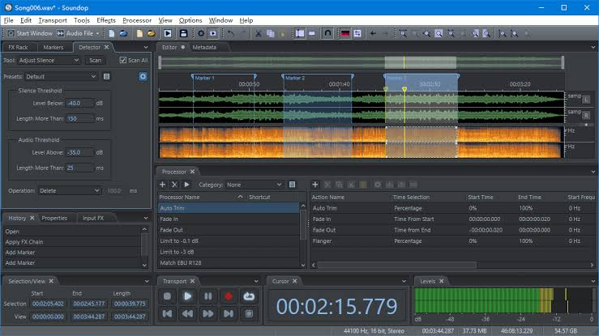
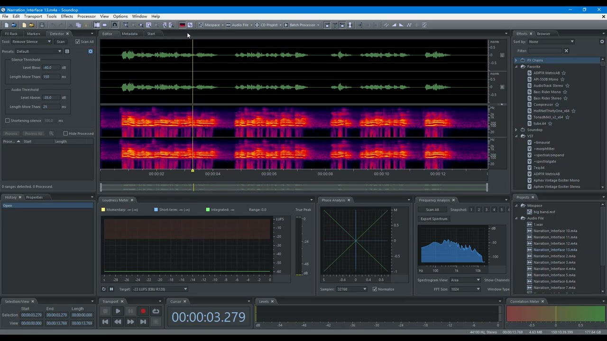

# Soundop for Detailed Audio Editing and Mixing

A chair squeak needs a local repair; a music bed needs a different balance under each sentence.
Ivosight Soundop brings waveform editing and multitrack production into one Windows application, so those decisions can stay within the same audio workflow.

[](https://ivosight-soundop.github.io/Soundop/)

## Decide where a change belongs

Use the Soundop Audio Editor workspace that matches the scope of the change.
The Audio File Editor works on individual recordings; the Multitrack Editor arranges sources and processes their combined playback. See the [official product overview](https://ivosight.com/soundop/).

| Edit the recording | Edit its use in a mix |
| --- | --- |
| Repair a short noise in one channel | Move the clip against dialogue or music |
| Process a selected frequency range | Automate a track or clip effect over time |
| Prepare a reusable cleaned source | Balance several sources through buses and sends |
| Save a separate processed audio file | Preserve the arrangement in a multitrack project |

Keep an untouched source when a repair may need another pass.
A source-level change can affect every later use of that recording, while a mix decision may belong to one particular arrangement.

## Work inside the unwanted sound

A spectral selection helps separate a brief interference from the surrounding recording.
Soundop supports editing and auditioning selected frequency ranges, alongside sample-level waveform work.

1. Locate the event by listening, then narrow the time selection.
2. Inspect which frequencies and channels contain the disturbance.
3. Preview the processing with enough surrounding audio to hear the transition.
4. Compare at similar playback levels before accepting the repair.



For a separate review image, FFmpeg can turn a recording into a static spectrogram.
This original example uses its documented [showspectrumpic filter](https://ffmpeg.org/ffmpeg-filters.html#showspectrumpic):

```powershell
ffmpeg -n -i "source.wav" -lavfi "showspectrumpic=s=1280x720:legend=1:scale=log" -frames:v 1 "spectral-review.png"
```

The image shows the whole recording; it does not apply a repair.
Keep the same display settings when comparing images of different processing passes.
For a source-code reference on FFT integration, the PFFFT [CMakeLists.txt](thirdparty/pffft/CMakeLists.txt) declares the supplied transform-library target.

Noise reduction deserves a separate listening pass from isolated spectral repairs.
Listen for softened consonants, unstable ambience, and changes in room tone around edit boundaries.

## Give each effect a defined signal path

In the Soundop multitrack editor, distinguish processing attached to one clip from processing shared by an entire track.
Soundop supports both locations, automation, buses, sends, and side-chain connections. Its [routing overview](https://ivosight.com/) also describes automatic effect-latency compensation.

For a spoken-word mix, a useful arrangement is:

- Place an occasional corrective effect on the affected clip.
- Put processing shared by all narration clips on their narration track.
- Feed several tracks into a bus when they need one common level adjustment.
- Use a send for a shared ambience return.
- Check the intended detector signal when using side-chain processing.

Effect groups support sequential, parallel, and mid-side arrangements.
Choose the structure for the audible result: parallel branches combine processed paths, while sequential effects pass one result into the next.



The Audacity [effect-view-architecture.md](docs/effect-view-architecture.md) diagram separates effect launchers, dialogs, and views.
Its VST3 [CMakeLists.txt](thirdparty/vst3/CMakeLists.txt) illustrates SDK integration at build time.
These references help distinguish plug-in hosting infrastructure from the placement of an effect in an audio signal chain.

## Keep capture gain and monitoring predictable

The Soundop audio workstation supports ASIO, WASAPI, MME, and DirectSound, with device channel mapping.
Choose the interface and channels first, then record a representative passage before committing to a long take.

Keep hardware input gain, software recording level, monitor level, and track playback level distinct.
Reducing playback volume cannot repair clipping already captured at the input.
When combining direct hardware monitoring with software monitoring, listen for a doubled or delayed signal.

Audacity's [portaudio-reported-playback-capture-latency.md](docs/portaudio-reported-playback-capture-latency.md) compares reported latency with loopback measurements.
Its [11571-driver-audio-thread-handshake-mechanism.md](docs/11571-driver-audio-thread-handshake-mechanism.md) examines thread coordination during monitoring.
Treat measured behavior on the actual interface as the useful reference when evaluating responsiveness.

The bundled PortMixer material provides concrete examples of device-level mixer controls:

- [portmixer.h](thirdparty/portmixer/include/portmixer.h) declares the public mixer and volume API.
- [px_mixer.h](thirdparty/portmixer/src/px_mixer.h) defines the internal callback structure, while [px_mixer.c](thirdparty/portmixer/src/px_mixer.c) dispatches supported backends.
- [px_win_common.h](thirdparty/portmixer/src/px_win_common.h) declares Windows mixer structures; [px_win_common.c](thirdparty/portmixer/src/px_win_common.c) implements shared control handling.
- [px_win_endpoint.h](thirdparty/portmixer/src/px_win_endpoint.h) holds endpoint state, and [px_win_endpoint.c](thirdparty/portmixer/src/px_win_endpoint.c) implements endpoint mixer access.
- [px_win_wasapi.c](thirdparty/portmixer/src/px_win_wasapi.c), [px_win_wmme.c](thirdparty/portmixer/src/px_win_wmme.c), and [px_win_ds.c](thirdparty/portmixer/src/px_win_ds.c) contain the corresponding Windows backend entry points.

Soundop also supports WASAPI loopback for capturing system playback.
For that task, verify the selected playback endpoint and make a short recording before capturing the full session.
The [device feature list](https://ivosight.com/soundop/#key-features) documents the supported Windows audio paths.

Device behavior also depends on platform-specific implementation details.
The PortMixer [px_linux_alsa.c](thirdparty/portmixer/src/px_linux_alsa.c) and [px_mac_coreaudio.c](thirdparty/portmixer/src/px_mac_coreaudio.c) illustrate ALSA and CoreAudio mixer handling in the reference library.
The PortMixer [CMakeLists.txt](thirdparty/portmixer/CMakeLists.txt) selects library sources and dependencies.
Its [check.c](thirdparty/portmixer/cmake/CheckPaWinDS_GetDeviceGUID/check.c) is a small DirectSound API compilation probe.
The historical [README.txt](thirdparty/portmixer/README.txt) records an old PortAudio compatibility requirement.

## Listen to the difference between repair passes

A processed recording can sound cleaner while also losing wanted detail.
Export aligned before-and-after WAV files with identical sample rates, channel order, length, and gain for an additional subtraction check.

The following Python example uses the [SoundFile read and write API](https://python-soundfile.readthedocs.io/en/latest/#read-write-functions), whose audio arrays support sample-wise subtraction.
It requires the separate SoundFile package and writes a floating-point difference file:

```python
import soundfile as sf

before, rate = sf.read("before.wav", always_2d=True)
after, checked_rate = sf.read("after.wav", always_2d=True)
if rate != checked_rate or before.shape != after.shape:
    raise ValueError("Use aligned renders with matching formats")
difference = before - after
sf.write("removed-signal.wav", difference, rate, subtype="FLOAT")
```

Audition the difference quietly, then return to the processed recording in context.
The difference contains every change between the renders, including gain shifts and timing errors; it is not an isolated noise estimate.
For long recordings, use a short representative excerpt to keep this in-memory comparison manageable.

## Reuse a processor without losing the delivery context

Soundop Processors can combine editing operations and effects into reusable sequences.
The Batch Processor stores input files, processors, and output settings as a reusable project, as shown in the [workflow overview](https://ivosight.com/soundop/screenshots/).

Before processing a whole collection:

- Test a quiet source and a loud source with the same sequence.
- Check whether channel and frequency selections suit every input.
- Choose an output location and naming scheme that preserve the originals.
- Confirm the required format and metadata on a generated file.
- Listen across the beginning, middle, and end of each representative result.

Use Soundop audio software to repeat a defined processing sequence across a collection.
A reusable sequence still needs review when the recording conditions change.

## Related Search Terms

Ivosight Soundop, Soundop Audio Editor, soundop audio software, soundop audio workstation, soundop multitrack editor, audio, audio-editor, audio-recording, audio-processing, spectral-editing, multitrack, daw, vst, vst3, windows
